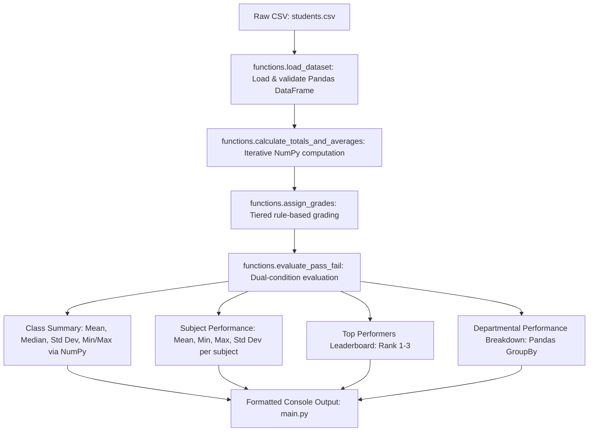

# Student Performance Analytics System


> **EWB Courses | Python with AI — Final Project Assignment**  
> **Student:** Ansh  
> **GitHub Repository:** [https://github.com/anshk025/Student-Performance-Analytics-System](https://github.com/anshk025/Student-Performance-Analytics-System)  
> **Submission Deadline:** 15 October 2026  

---

## 1. Project Title & Student Details

* **Project Title:** Student Performance Analytics System
* **Course:** Python with AI (EWB Courses)
* **Student Name:** Ansh
* **GitHub Profile:** [@anshk025](https://github.com/anshk025)
* **Repository Link:** [https://github.com/anshk025/Student-Performance-Analytics-System](https://github.com/anshk025/Student-Performance-Analytics-System)
* **Domain:** Educational Data Analytics & Python Data Science

---

## 2. Objective

Educational institutions routinely manage large volumes of student evaluation data, including marks across multiple subjects, departmental records, and attendance percentages. Manual calculation of aggregates, grading distributions, pass/fail identification, and subject benchmarks is tedious and prone to human error.

The **Student Performance Analytics System** was developed to:
1. Provide an automated, accurate, and reproducible data pipeline to ingest student academic records.
2. Leverage **NumPy** for vector and numerical calculations (means, totals, medians, standard deviations, and min/max boundaries).
3. Utilize **Pandas DataFrames** to structure, filter, aggregate, and present educational data.
4. Enforce transparent academic standards (grade tiers and strict pass/fail criteria including subject cutoffs and attendance requirements).
5. Generate clear, actionable insights for academic administrators, such as subject strengths/weaknesses and top-performing student leaderboards.

---

## 3. Technologies Used

* **Language:** Python 3 (Variables, loops, conditionals, functions, type handling)
* **Data Manipulation:** `pandas` (DataFrames, Series, aggregation, group-by)
* **Numerical Computing:** `numpy` (`np.mean`, `np.sum`, `np.median`, `np.std`, `np.min`, `np.max`, ndarrays)
* **Verification & Testing:** `unittest` (7 automated test cases verifying calculations and edge cases)
* **Version Control:** Git & GitHub

---

## 4. Dataset Description

The dataset is stored in [`students.csv`](students.csv) and contains 20 student records across diverse engineering departments with realistic distributions of scores and attendance levels.

### Attributes / Columns

| Column Name | Data Type | Description | Valid Range / Example |
| :--- | :--- | :--- | :--- |
| `Student_ID` | Integer | Unique identifier for each student | 101 – 120 |
| `Name` | String | Full name of the student | e.g. Aarav Sharma, Ananya Iyer |
| `Department` | String | Academic department / major | Computer Science, Electronics, Mechanical, Civil |
| `Math_Marks` | Integer | Score obtained in Mathematics | 0 – 100 (Observed: 35 – 95) |
| `Science_Marks` | Integer | Score obtained in Science | 0 – 100 (Observed: 39 – 97) |
| `English_Marks` | Integer | Score obtained in English | 0 – 100 (Observed: 41 – 94) |
| `Attendance_Percentage` | Integer | Overall lecture attendance percentage | 0 – 100% (Observed: 68 – 98%) |

---

## 5. Implementation

The project follows a clean, modular structure separating reusable computational logic ([`functions.py`](functions.py)) from presentation and execution orchestration ([`main.py`](main.py)).

### Step-by-Step Workflow



1. **Step 1 – Dataset Loading (`load_dataset`):**
   Reads `students.csv` into a Pandas DataFrame with fallback path detection to ensure cross-platform compatibility and guard against `FileNotFoundError`.

2. **Step 2 – Quantitative Metric Calculations (`calculate_totals_and_averages`):**
   Iterates through each student using loops, extracts subject scores into NumPy arrays, and executes `np.sum()` and `np.mean()` to compute `Total_Marks` and `Average_Marks`.

3. **Step 3 – Grading Assignment (`assign_grades`):**
   Iterates through computed student averages and assigns grades based on a clearly defined grading matrix:
   * **Grade A:** Average $\ge$ 85% (Distinction)
   * **Grade B:** 70% $\le$ Average $<$ 85% (First Class)
   * **Grade C:** 55% $\le$ Average $<$ 70% (Second Class)
   * **Grade D:** 40% $\le$ Average $<$ 55% (Pass Class)
   * **Grade F:** Average $<$ 40% (Fail)

4. **Step 4 – Dual-Criterion Pass/Fail Evaluation (`evaluate_pass_fail`):**
   Applies educational criteria where a student must satisfy **both**:
   * Minimum passing threshold in **every** individual subject: $\ge 40$ marks.
   * Minimum attendance requirement: $\ge 75\%$.
   If a student scores $<40$ in any subject or has $<75\%$ attendance, they are marked as **Fail**, and specific diagnostic remarks (e.g. *Low Attendance (72%)* or *Failed in Science*) are recorded.

5. **Step 5 – Statistical Analysis (`calculate_overall_class_summary`, `calculate_subject_performance`):**
   * Class summary metrics calculated using NumPy: `np.mean`, `np.median`, `np.std`, `np.max`, `np.min`.
   * Subject-wise performance metrics computed across Mathematics, Science, and English.
   * Top 3 performers identified by sorting total and average marks descending.
   * Departmental grouping computed via Pandas `.groupby()`.

---

## 6. Key Features

* **Modular Architecture:** Core analytical functions isolated in `functions.py` for reusability and maintainability.
* **Vectorized & Numerical Accuracy:** NumPy handles all aggregation, guaranteeing precision.
* **Realistic Business Logic:** Considers both subject-level minimums and attendance constraints.
* **Multi-Subject Breakdown:** Calculates highest, lowest, average, and standard deviation for each subject.
* **Comprehensive Diagnostic Feedback:** Explains *why* each failing student did not clear the term.
* **Departmental Grouping:** Breaks down average scores and attendance across departments.
* **Automated Unit Testing:** Includes 7 unit tests in [`test_system.py`](test_system.py).

---

## 7. Output & Terminal Results

When running `python main.py`, the system generates the following clean, human-readable terminal output:

```text
================================================================================
===================== STUDENT PERFORMANCE ANALYTICS SYSTEM =====================
================================================================================
 Developed for EWB Courses | Python with AI Assignment
 Author: Ansh | GitHub: https://github.com/anshk025/Student-Performance-Analytics-System
================================================================================

--------------------------------------------------------------------------------
  STEP 1 & 2: DATASET LOADING AND INSPECTION
--------------------------------------------------------------------------------
[+] Dataset loaded successfully from 'students.csv'.
[+] Total Student Records Found: 20
[+] Columns: Student_ID, Name, Department, Math_Marks, Science_Marks, English_Marks, Attendance_Percentage

--------------------------------------------------------------------------------
  STEP 3: DATA PROCESSING (NUMPY & PANDAS)
--------------------------------------------------------------------------------
[-] Calculating Total Marks & Average Marks using NumPy...
[-] Assigning Letter Grades based on defined grading criteria...
[-] Evaluating Pass/Fail status based on subject cutoffs (>=40) and attendance (>=75%)...
[+] Data processing complete.

Processed Student Scorecards:
 Student_ID            Name       Department  Math_Marks  Science_Marks  English_Marks  Total_Marks  Average_Marks Grade  Attendance_Percentage Status
        101    Aarav Sharma Computer Science          88             92             79          259          86.33     A                     94   Pass
        102      Priya Nair      Electronics          76             81             85          242          80.67     B                     88   Pass
        103     Rohan Mehta       Mechanical          54             48             62          164          54.67     D                     72   Fail
        104     Ananya Iyer Computer Science          95             97             91          283          94.33     A                     98   Pass
        105     Karan Patel            Civil          43             39             58          140          46.67     D                     81   Fail
        106     Sneha Reddy      Electronics          67             72             70          209          69.67     C                     79   Pass
        107    Vikram Singh       Mechanical          81             74             68          223          74.33     B                     85   Pass
        108     Divya Menon Computer Science          72             78             83          233          77.67     B                     91   Pass
        109     Arjun Verma            Civil          59             63             55          177          59.00     C                     68   Fail
        110     Meera Joshi      Electronics          90             86             94          270          90.00     A                     96   Pass
        111     Rahul Gupta       Mechanical          35             52             47          134          44.67     D                     77   Fail
        112     Pooja Desai            Civil          78             69             81          228          76.00     B                     83   Pass
        113   Siddharth Rao Computer Science          62             58             66          186          62.00     C                     74   Fail
        114     Neha Kapoor      Electronics          84             89             77          250          83.33     B                     90   Pass
        115 Aditya Kulkarni       Mechanical          70             65             73          208          69.33     C                     87   Pass
        116     Isha Bansal            Civil          91             88             93          272          90.67     A                     95   Pass
        117    Manish Yadav Computer Science          48             55             41          144          48.00     D                     80   Pass
        118    Kavya Pillai      Electronics          73             70             76          219          73.00     B                     82   Pass
        119    Harsh Tiwari            Civil          66             45             60          171          57.00     C                     76   Pass
        120      Tanvi Shah       Mechanical          82             79             88          249          83.00     B                     92   Pass

--------------------------------------------------------------------------------
  STEP 4: PRACTICAL QUESTIONS & EXECUTIVE SUMMARY
--------------------------------------------------------------------------------
 1. Overall Class Average Marks : 71.02 / 100
 2. Student with Highest Average: Ananya Iyer (ID: 104) (Score: 94.33%)
 3. Student with Lowest Average : Rahul Gupta (ID: 111) (Score: 44.67%)
 4. Subject with Best Average   : English
 5. Pass/Fail Student Count     : Passed: 15 (75.0%) | Failed: 5 (25.0%)

--------------------------------------------------------------------------------
  OVERALL CLASS PERFORMANCE (NUMPY COMPUTED)
--------------------------------------------------------------------------------
 * Total Enrolled Students : 20
 * Class Mean Average      : 71.02
 * Class Median Score      : 73.66
 * Standard Deviation      : 15.01
 * Highest Score           : 94.33 (Ananya Iyer (ID: 104))
 * Lowest Score            : 44.67 (Rahul Gupta (ID: 111))

--------------------------------------------------------------------------------
  SUBJECT-WISE PERFORMANCE ANALYSIS
--------------------------------------------------------------------------------
Subject  Average Marks  Highest Marks  Lowest Marks  Std Deviation
   Math          70.70             95            35          16.21
Science          70.00             97            39          16.24
English          72.35             94            41          14.79

--------------------------------------------------------------------------------
  PASS / FAIL CRITERIA EVALUATION
--------------------------------------------------------------------------------
Criteria:
  1. Minimum 40 marks in each individual subject (Math, Science, English).
  2. Minimum 75% overall attendance.

Summary:
  * Students Passed: 15 / 20 (75.0%)
  * Students Failed: 5 / 20 (25.0%)

Breakdown of Unsuccessful Candidates & Underlying Reasons:
 Student_ID          Name       Department  Attendance_Percentage               Remark
        103   Rohan Mehta       Mechanical                     72 Low Attendance (72%)
        105   Karan Patel            Civil                     81    Failed in Science
        109   Arjun Verma            Civil                     68 Low Attendance (68%)
        111   Rahul Gupta       Mechanical                     77       Failed in Math
        113 Siddharth Rao Computer Science                     74 Low Attendance (74%)

--------------------------------------------------------------------------------
  TOP 3 PERFORMING STUDENTS
--------------------------------------------------------------------------------
 Rank #1: Ananya Iyer (ID: 104) | Dept: Computer Science | Total: 283 | Avg: 94.33% | Grade: A | Attendance: 98%
 Rank #2: Isha Bansal (ID: 116) | Dept: Civil | Total: 272 | Avg: 90.67% | Grade: A | Attendance: 95%
 Rank #3: Meera Joshi (ID: 110) | Dept: Electronics | Total: 270 | Avg: 90.0% | Grade: A | Attendance: 96%

--------------------------------------------------------------------------------
  DEPARTMENT-WISE PERFORMANCE SUMMARY
--------------------------------------------------------------------------------
      Department  Student_Count  Average_Marks  Average_Attendance
           Civil              5          65.87                80.6
Computer Science              5          73.67                87.4
     Electronics              5          79.33                87.0
      Mechanical              5          65.20                82.6

================================================================================
================== Analytics Pipeline Completed Successfully ===================
================================================================================
```

---

## 8. Final Outcome

The project successfully addressed every required question and deliverable:
1. **Highest Performing Student:** Ananya Iyer (ID: 104) with an average of **94.33%** and total marks of **283**.
2. **Lowest Performing Student:** Rahul Gupta (ID: 111) with an average of **44.67%**.
3. **Subject with Best Performance:** **English** with a class average of **72.35**, followed closely by Mathematics (70.70) and Science (70.00).
4. **Pass/Fail Distribution:** **15 students (75.0%) passed** and **5 students (25.0%) failed**.
5. **Class Aggregate Average:** **71.02%** with a standard deviation of **15.01**.
6. **Top Department:** **Electronics** achieved the highest departmental average (**79.33%**).

---

## 9. Challenges & Learning

### Challenges Faced
* **Multi-Criteria Conditions:** Combining subject cutoffs across arbitrary subjects with an attendance threshold required careful data handling to produce descriptive failure reasons rather than simple binary flags.
* **Path Resolution across Platforms:** Ensuring `students.csv` is correctly loaded whether invoked from the repository root or subfolders was solved using script-relative directory resolution.
* **Windows Terminal Encoding:** Some default command line environments in Windows fail to display Unicode glyphs (such as bullet points). Replacing these with standard ASCII representations ensured universal readability.

### Key Learnings
* Gained proficiency in coupling Pandas DataFrames with NumPy numerical routines (`np.mean`, `np.std`, `np.median`).
* Learned how to structure modular Python software with reusable functions and automated unit testing.
* Mastered Git and GitHub workflows for reproducible project submissions.

---

## 10. How to Run the Project

### Prerequisites
Make sure Python 3.8+ and the required packages are installed:
```bash
pip install pandas numpy
```

### Execution
Run the main analytics script:
```bash
python main.py
```

### Running Unit Tests
To verify all calculations and test cases:
```bash
python -m unittest test_system.py
```

---

## 11. GitHub Repository Link

* **Official Repository:** [https://github.com/anshk025/Student-Performance-Analytics-System](https://github.com/anshk025/Student-Performance-Analytics-System)
